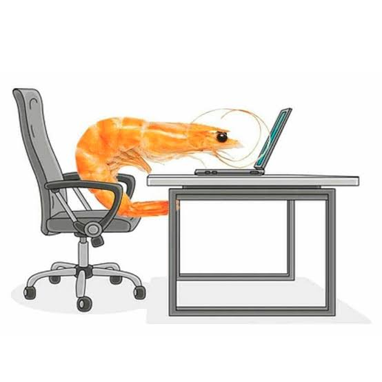

# 🦐 AntiGamba

> **Stop shrimping.** The native ergonomic sit-stand-move companion for macOS developers.

[](https://apple.com)
[](https://swift.org)
[](LICENSE)
[](#)

<p align="center">
  
  <br>
  <em>Tired of finishing your day looking like a curved shrimp? AntiGamba has your back (literally).</em>
</p>

---

## 💡 The Problem

If you spend 8+ hours a day coding or working at a desk:
- **Traditional Pomodoro (25/5)** wasn't designed for sit-stand desks or posture changes.
- **Break reminder apps** dim or lock your screen for 10–15 minutes, assuming every break means leaving your computer. But with an adjustable desk, **you still want to work while standing!**
- Setting manual alarms on your phone or macOS Clock has high friction, breaks flow, and easily gets forgotten.

## ✨ The Solution: The 40-15-3 Ergo Cycle

**AntiGamba** is a zero-bloat, native macOS menu bar app that automates an ergonomic work cycle:

```
🦐 40 min Sitting ➔ 🧍 15 min Standing Desk ➔ 🚶 3 min Active Movement ➔ 🔁 Loop
```

1. **🦐 40 min — Sitting & Deep Work:** Sit straight and focus on your code.
2. **🧍 15 min — Standing Work:** A gentle alert prompts you to raise your desk. Hit *"Start"* and keep working with **100% free screen space** (no annoying screen blockers).
3. **🚶 3 min — Movement & Hydration:** Step away from the screen, stretch, drink water, or walk around.
4. **🔁 Repeat:** Automatically resets for your next productive block.

---

## 🚀 Key Features

* **🔔 Disruptive Floating Alerts:** When a phase finishes, a centered frosted-glass modal appears on top of your windows with a clean sound. Choose between `Start`, `Postpone 5m`, or `Skip`.
* **🖥️ 100% Native & Featherweight:**
  * Built purely with **Swift 6 & SwiftUI**.
  * Consumes **< 30 MB of RAM** and **0% CPU** at idle.
  * Binary size is **< 1 MB** (no Electron, no web runtime bloat).
* **🎯 Minimalist Menu Bar Extra:** Shows live countdown discreetly (`🦐 39:45` / `🧍 14:20` / `🚶 02:45`).
* **⚙️ Fully Customizable:** Tweak durations (e.g., 30m sitting, 10m standing, 2m moving) directly from the settings panel.
* **🔒 100% Private & Offline:** No accounts, no analytics, no network calls.

---

## 📥 Installation

### Option 1: Direct Download (Recommended)

1. Download the latest `AntiGamba.zip` from the [Releases](https://github.com/OscarJRM/antigamba/releases) page.
2. Unzip it and drag `AntiGamba.app` into your **Applications** folder (`/Applications`).
3. Launch it from Applications or Spotlight.

> **Note for macOS Gatekeeper:**  
> Since AntiGamba is an independent open-source project without a paid Apple Developer certificate, on the very first launch macOS may show a security notice. Simply **Right-click (or Control-click) `AntiGamba.app` ➔ click "Open" ➔ Confirm "Open"**.

### Option 2: Build From Source

Requirements: macOS 13.0+ and Swift 6+ (Command Line Tools).

```bash
git clone https://github.com/OscarJRM/antigamba.git
cd antigamba

# Compile and build the native .app bundle
./scripts/build_app.sh

# Run
open AntiGamba.app
```

---

## ⌨️ Architecture

```
Sources/AntiGamba/
├── AntiGamba.swift            # Main App & MenuBarExtra definition
├── Models/
│   ├── PostureState.swift     # 3-phase state definition (Sitting, Standing, Moving)
│   └── CycleManager.swift     # Timer engine, state transitions & loop management
├── Views/
│   ├── MenuBarView.swift      # Popover status card (progress bar, controls, settings)
│   └── AlertModalView.swift   # Frosted glass floating alert view
└── Services/
    └── OverlayManager.swift   # Floating NSPanel coordinator with system audio
```

---

## 🤝 Contributing

Contributions, feedback, and ideas are warmly welcome!
1. Fork the repo.
2. Create your feature branch (`git checkout -b feature/awesome-idea`).
3. Commit your changes (`git commit -m 'feat: add awesome idea'`).
4. Push to the branch (`git push origin feature/awesome-idea`).
5. Open a Pull Request.

---

## 📄 License

Distributed under the **MIT License**. See [LICENSE](LICENSE) for details.

---

<p align="center">
  Crafted with ❤️ by <a href="https://github.com/OscarJRM">OscarJRM</a> to keep developers standing tall.
</p>
