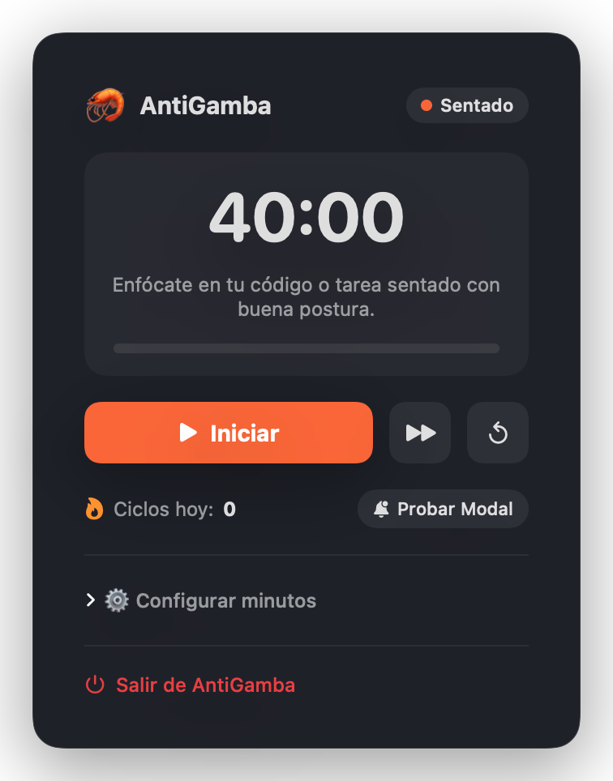
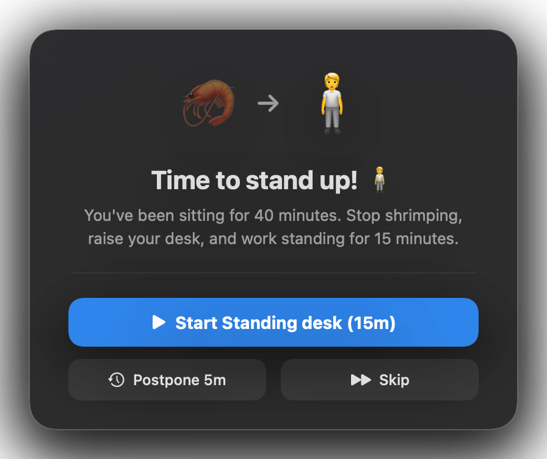

# 🦐 AntiGamba

> Featherweight ergonomic companion for macOS developers with standing desks.

[](https://oscarjrm.github.io/antigamba/)
[](https://apple.com)
[](https://swift.org)
[](LICENSE)
[](#)

<p align="center">
  
  &nbsp;&nbsp;&nbsp;&nbsp;
  
</p>

---

## The 40-15-3 Ergo Loop

Traditional Pomodoro (25/5) wasn't designed for sit-stand desks, and traditional break reminders lock your screen for 10+ minutes. AntiGamba automates continuous posture rotation without interrupting your workflow:

```
40 min Sitting ➔ 15 min Standing Desk ➔ 3 min Active Movement ➔ Repeat
```

1. **40 min — Sitting Focus:** Sit upright and focus on deep engineering.
2. **15 min — Standing Work:** A gentle alert prompts you to raise your desk. Hit *Start* and keep coding with 100% free screen space.
3. **3 min — Active Break:** Step away from the screen, stretch your spine, and hydrate.
4. **Repeat:** Resets automatically for your next productive block.

---

## Features

- **Disruptive Floating Alerts:** Centered frosted-glass modals appear on phase completion with native sound prompts (`Start`, `Postpone 5m`, or `Skip`).
- **100% Native & Featherweight:**
  - Written purely in Swift 6 and SwiftUI.
  - Consumes `< 30 MB` of RAM and `0% CPU` at idle.
  - Universal binary under `1 MB` (no Electron, no web runtime).
- **Minimalist Menu Bar:** Live discreet countdown (`🦐 39:45` / `🧍 14:20` / `🚶 02:45`) or compact icon-only mode.
- **Customizable Durations:** Adjust sitting, standing, and moving timers directly in Settings.
- **Bilingual Support:** Adapts automatically to English or Spanish based on macOS system language.
- **Day Persistence:** Daily completed cycles persist across restarts and reset each morning.
- **Launch at Login:** Uses modern Apple `SMAppService` with zero daemon bloat.
- **Private & Offline:** Zero analytics, zero telemetry, no network requests.

---

## Installation

### Direct Download (Recommended)

1. Download the latest `AntiGamba.zip` from the [Releases](https://github.com/OscarJRM/antigamba/releases) page.
2. Unzip and move `AntiGamba.app` to your `/Applications` folder.
3. Launch via Applications or Spotlight.

> **macOS Gatekeeper Note:**  
> Since AntiGamba is an independent open-source project without a paid Apple Developer certificate, on first launch macOS may display an unidentified developer warning. **Right-click (or Control-click) `AntiGamba.app` ➔ click "Open" ➔ Confirm "Open"**.

### Build from Source

Requirements: macOS 13.0+ and Xcode Command Line Tools.

```bash
git clone https://github.com/OscarJRM/antigamba.git
cd antigamba

# Compile and package native .app bundle
./scripts/build_app.sh

# Run
open AntiGamba.app
```

---

## Architecture

```
Sources/AntiGamba/
├── AntiGamba.swift            # App entrypoint & MenuBarExtra definition
├── Models/
│   ├── PostureState.swift     # 3-phase state definition (Sitting, Standing, Moving)
│   ├── CycleManager.swift     # Timer engine, state machine & loop management
│   ├── AppSettings.swift      # User settings (compact mode, sounds, launch at login)
│   └── L10n.swift             # Localization engine (EN / ES / System)
├── Views/
│   ├── MenuBarView.swift      # Popover status card (progress bar, controls, settings)
│   └── AlertModalView.swift   # Frosted-glass floating alert view
└── Services/
    └── OverlayManager.swift   # Floating NSPanel coordinator with system audio
```

---

## Contributing

Contributions, issues, and feature requests are welcome:

1. Fork the repository.
2. Create your feature branch (`git checkout -b feature/idea`).
3. Commit your changes (`git commit -m 'feat: add idea'`).
4. Push to your branch (`git push origin feature/idea`).
5. Open a Pull Request.

---

## License

Distributed under the [MIT License](LICENSE).

---

Developed by [Oscar Joel Ramírez](https://github.com/OscarJRM) (OscarJRM).
